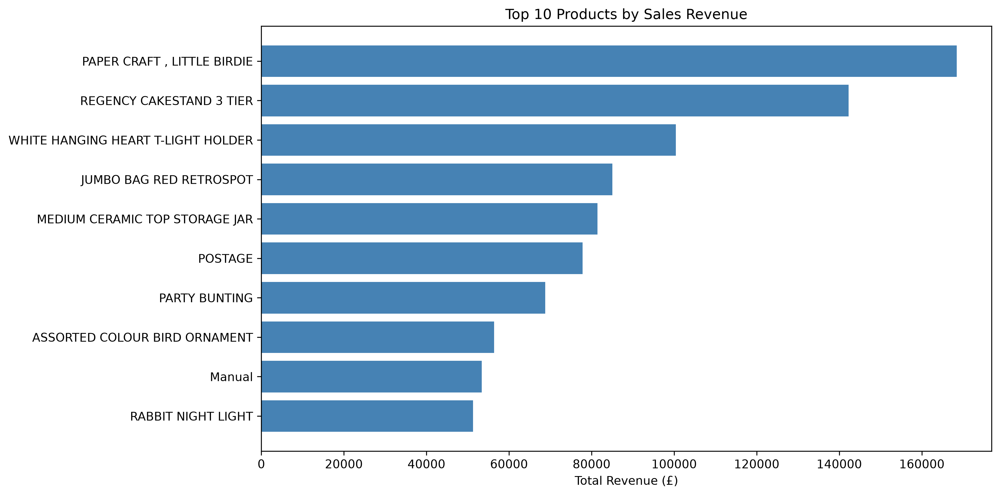
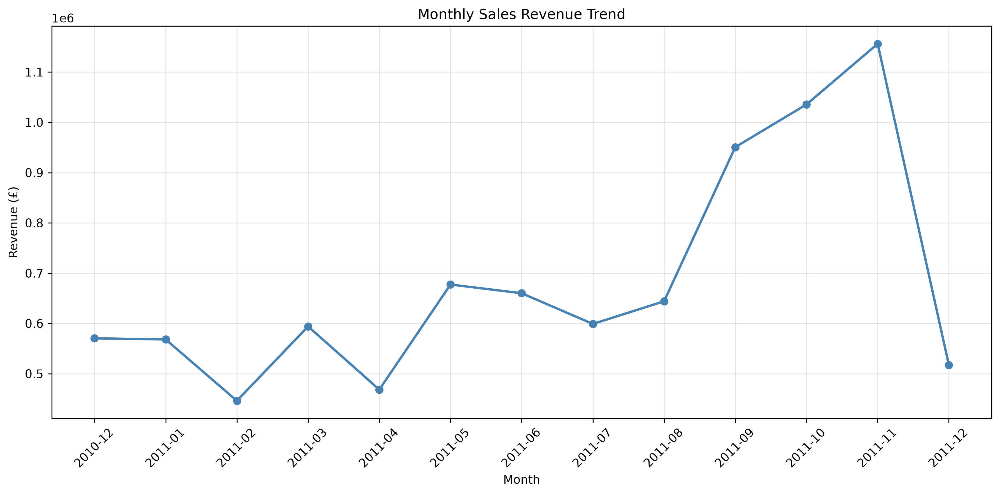
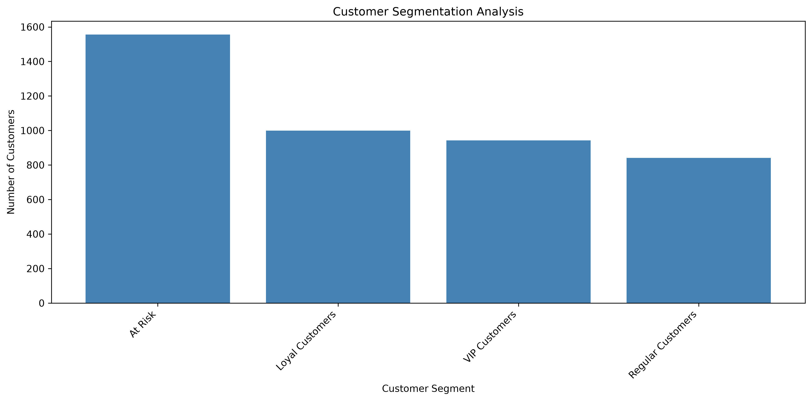

# E-Commerce Customer Retention & Sales Performance Analytics
## Final Business Analysis Report

**Prepared by:** Akhila Jangam  
**Date:** November 2026  
**Tools:** Python, pandas, matplotlib, SQL, Excel Power Query, Power BI, GitHub

---

## 1. Executive Summary

This project analyzes e-commerce sales transactions, customer purchasing behavior, and product performance to identify opportunities for business improvement.

The analysis focuses on revenue performance, product demand, customer segmentation, and operational recommendations for Inventory and Sales teams.

### Key Business Metrics

| Metric | Value |
|---|---:|
| Total Sales Revenue | £8,887,208.89 |
| Total Orders | 18,532 |
| Total Units Sold | 5,152,002 |
| Average Order Value | £479.56 |

These metrics were calculated from positive sales transactions after excluding returns and invalid sales.

## 2. Business Objectives

- Analyze overall revenue and sales performance.
- Identify top-performing products.
- Examine monthly sales trends.
- Evaluate customer purchasing behavior using RFM segmentation.
- Recommend improvements for inventory planning and sales performance.

## 3. Data Preparation and Methodology

The project used historical retail transaction data.

Data preparation included:

- Reviewing missing values and duplicate records.
- Validating quantities and unit prices.
- Excluding cancellation transactions from positive sales KPIs.
- Calculating transaction revenue using quantity multiplied by unit price.
- Aggregating product and monthly revenue.
- Analyzing customer behavior using RFM segmentation.

Python and SQL supported data analysis, while Power BI and matplotlib supported visualization.

## 4. Sales Performance Analysis

The analyzed transactions generated £8.89 million in sales revenue across 18,532 orders.

The average order value was approximately £479.56.

These results establish a baseline for monitoring future sales performance.

## 5. Product Performance Analysis

The Top 10 Products by Revenue analysis identifies the products generating the highest sales revenue.

**Business Implications:**

- High-revenue products warrant regular availability monitoring.
- Products with consistently high unit demand may require more frequent replenishment.
- Product-level demand patterns can support purchasing decisions.

**Visualization:** `top_10_products.png`

## 6. Monthly Revenue Trend Analysis

Monthly revenue was aggregated using invoice dates to evaluate sales performance over time.

**Business Implications:**

- Monthly revenue trends can help identify changes in customer demand.
- Recurring demand peaks may inform inventory planning.
- Sales teams can use historical trends to schedule promotional campaigns.

Seasonal conclusions should be validated against the available date range and any incomplete months.

**Visualization:** `monthly_sales_trend.png`

## 7. Customer Segmentation Analysis

RFM segmentation was used to group customers according to:

- **Recency:** How recently customers purchased.
- **Frequency:** How often customers purchased.
- **Monetary Value:** How much customers spent.

The segmentation analysis provides a foundation for targeted retention strategies.

**Business Implications:**

- Valuable repeat customers may benefit from loyalty initiatives.
- At-risk customers may be suitable for re-engagement campaigns.
- Customer segments can support more relevant marketing offers.

**Visualization:** `customer_segmentation.png`

## 8. Inventory Team Recommendations

### 8.1 Prioritize High-Demand Products

Monitor top-selling products and assess replenishment needs using sales velocity, available stock, and supplier lead times.

### 8.2 Improve Demand Forecasting

Use historical product-level demand and monthly sales patterns to improve inventory planning.

### 8.3 Review Slow-Moving Products

Identify products with low sales velocity and evaluate potential overstock risks when inventory records are available.

## 9. Sales Team Recommendations

### 9.1 Strengthen Customer Retention

Develop targeted campaigns for valuable, loyal, and at-risk customer segments.

### 9.2 Optimize Promotional Campaigns

Use discount sensitivity findings to prioritize campaigns that support profitability rather than revenue alone.

### 9.3 Monitor Sales Performance

Track revenue, average order value, customer retention, and product-level sales through Power BI dashboards.

## 10. Recommended Implementation Plan

| Priority | Team | Action | Measurement |
|---|---|---|---|
| High | Inventory | Monitor high-demand products | Stockout rate |
| High | Sales | Target at-risk customers | Repeat purchase rate |
| Medium | Inventory | Improve demand forecasting | Forecast accuracy |
| Medium | Sales | Review discount effectiveness | Gross profit margin |
| Medium | Both | Coordinate sales and inventory planning | Product availability |

## 11. Limitations

The analysis uses historical transaction records and does not independently establish current inventory levels, supplier lead times, or future customer behavior.

Inventory recommendations require stock and supplier information before implementation.

Promotional profitability recommendations require reliable cost and margin information.

The expected business benefits are hypotheses to validate, not measured improvements.

## 12. Conclusion

The analysis establishes a sales performance baseline and provides a framework for improving product availability, customer retention, and promotional planning.

The Inventory team should focus on demand monitoring and forecasting, while the Sales team should prioritize customer retention and profitable promotional strategies.

Future analysis should combine sales transactions with inventory, supplier, and cost data to measure the impact of these recommendations.
### Top 10 Products by Revenue

### Monthly Sales Revenue Trend

### Customer Segmentation Distribution

